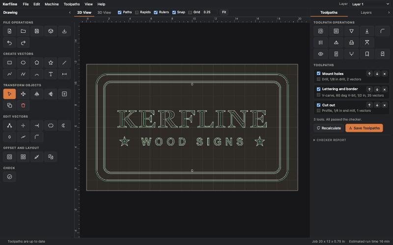
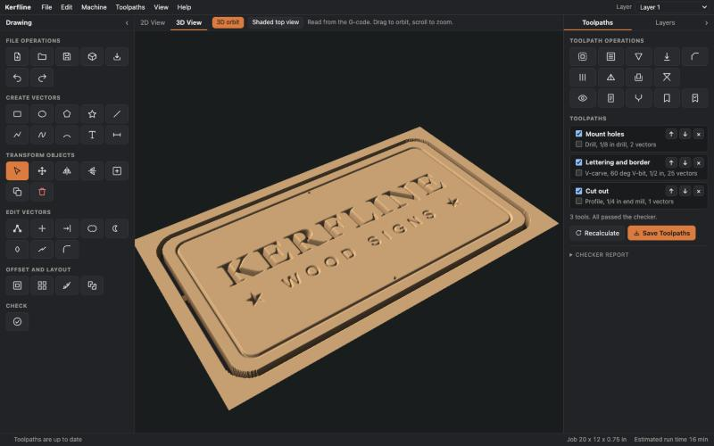

# Kerfline

Free 2D and V-carve CAM for CNC routers, on Mac, Windows, and Linux.

Draw or import your art, build toolpaths, watch a simulated cut in 3D, and save G-code that a built-in checker has read first. If you have used VCarve, the screen will feel familiar. It also imports your Vectric post processors and tool databases.

> [!WARNING]
> **This is test software. Its author has not run it on a real CNC machine yet.**
> Bad G-code can break bits, ruin material, damage machines, and hurt people. The checker cannot catch every mistake. Read every file, air-cut it above the material first, and keep a hand near the stop. Feeds and speeds are starting values only. You use this software at your own risk.





## Download

Get the newest test build from the [Releases page](https://github.com/quesohusker/kerfline/releases).

| System | File | How to start it |
|---|---|---|
| Mac, Apple silicon | `Kerfline-macOS-AppleSilicon.zip` | Unzip, then open Kerfline.app |
| Mac, Intel | `Kerfline-macOS-Intel.zip` | Unzip, then open Kerfline.app |
| Windows | `Kerfline-Windows.zip` | Unzip the whole folder, then run `Kerfline.exe` |
| Linux, x86-64 | `Kerfline-Linux.tar.gz` | Unpack, then run `Kerfline/Kerfline` |

Kerfline starts a small local server and opens in your web browser. It uses no account and needs no internet. To stop it, use **File, Quit Kerfline**.

The builds are not signed, so your computer will warn you the first time:

- **Mac:** Open Kerfline.app once and dismiss the warning. Then go to System Settings, Privacy & Security, and choose Open Anyway.
- **Windows:** On the SmartScreen warning, choose More info, then Run anyway.

`SHA256SUMS.txt` on the Releases page lets you check each download.

## What it does

**Design**
- Rectangle, ellipse, polygon, star, line, polyline, curve, and arc tools
- Text with kerning, text on a curve, and single-line engraving fonts
- Node editing, trim, extend, weld, subtract, intersect, offset, fillet, and dog-bone or T-bone corners
- Layers, rulers, guides, grid and smart snapping, and dimensions
- Grid and circular arrays, copies along a path, and true-shape nesting
- A vector checker for open shapes, overlaps, and duplicates
- Import SVG, DXF, PDF, AI, and EPS. Export SVG and DXF

**Toolpaths**
- Profile with tabs, ramps, and leads
- Pocket with islands, helix or ramp entry, and a finish pass
- Drill with pecking
- V-carve, including flat-bottom carving with a clearing tool
- Chamfer, fluting, and raised prism
- Auto-inlay and V-carve inlay
- Merged toolpaths, toolpath arrays, templates, and tiling for jobs larger than your bed

**Output**
- Built-in GRBL, Mach3 and Mach4, and LinuxCNC posts
- Import a Vectric `.pp` post processor and write G-code through it
- Edit posts in the app, with a live sample and checker result
- Import a Vectric `.vtdb` tool database, with tools, feeds, materials, and bed size
- Arc output (G2 and G3), keep-out zones, and an operator setup sheet

See [FEATURES.md](FEATURES.md) for the full list and what is planned.

## The G-code checker

Kerfline reads each finished G-code file with a separate checker before you can save it. The checker shares no code with the toolpath engine. It blocks a file that:

- Makes a rapid move below safe Z, or plunges into the material at rapid speed
- Cuts below the bottom of the material, past your spoilboard allowance
- Leaves the sheet, or enters a keep-out zone
- Cuts with the spindle off or with no feed rate
- Uses relative mode or a coordinate shift that it cannot follow

The 3D preview also runs from the G-code text, so you see what the file says and not what the program intended.

It warns but cannot follow machine-coordinate moves such as G53 or G28, which many posts use. Review those lines yourself.

## Testers wanted

The most useful reports come from real machines and real controllers.

1. Start with the sample job (File, Open sample job).
2. Save the G-code with your post, or import your own `.pp` file.
3. Read the file. Air-cut it above the material.
4. Then, if you are satisfied, cut scrap.

Please tell us about:

- Your machine, your controller, and your `.pp` post, and whether the output ran
- Any G-code that looked wrong, even if it passed the checker
- Anything that worked differently from what you expected
- Installs that failed on your computer

Open a [test report](https://github.com/quesohusker/kerfline/issues/new?template=test-report.md).

## Known limits

- Nothing has been proven on real hardware by the author.
- Each tool saves as its own file. Automatic tool changes in one file are not supported.
- Rotary and laser toolpaths are not supported. Rotary `.pp` posts are refused.
- Keep-out zones block a cut. Toolpaths do not route around them.
- Bowl bits and tapered ball nose bits import in a simplified form, and Kerfline tells you when it does this.
- EPS import reads common path commands only. AI files must be PDF compatible.
- Run times ignore acceleration, so they run low.

## Run from source

You need Python 3.12 or later.

```bash
git clone https://github.com/quesohusker/kerfline.git
cd kerfline
python3 -m venv .venv
.venv/bin/pip install -e ".[dev]"
.venv/bin/python -m kerfline
```

On Windows, use `.venv\Scripts\python`. Run the tests with `.venv/bin/python -m pytest -q`.

## How it is built

- `kerfline/toolpaths`: the toolpath engine. All values are in millimeters.
- `kerfline/verify.py`: the G-code checker. It imports no toolpath code.
- `kerfline/simulate.py`: cuts a height map from the G-code text.
- `kerfline/ppfile.py` and `kerfline/vtdb.py`: Vectric post and tool file readers.
- `kerfline/api.py` and `kerfline/server.py`: the local server, bound to 127.0.0.1.
- `kerfline/web`: the browser interface.
- `packaging`: the desktop builds.

## License and credits

Kerfline uses the [PolyForm Strict License 1.0.0](LICENSE). You may use it for free for noncommercial purposes. The license gives no warranty. Third-party parts keep their own licenses, listed in [THIRD_PARTY_NOTICES.md](THIRD_PARTY_NOTICES.md).

The Hershey Fonts were originally created by Dr. A. V. Hershey while working at the U. S. National Bureau of Standards. The format of the font data in this distribution was originally created by James Hurt, Cognition, Inc.

Kerfline is not made by, endorsed by, or connected with Vectric Ltd. VCarve, Aspire, and Vectric are trademarks of their owner. Kerfline ships no Vectric files or artwork. You supply your own post and tool files.
