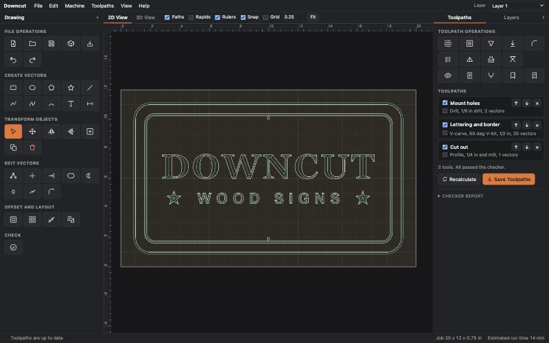
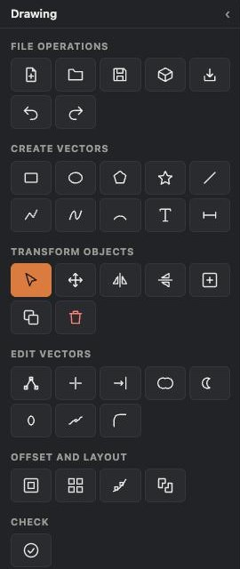
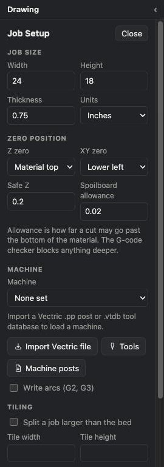
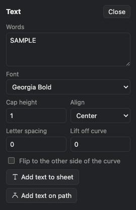
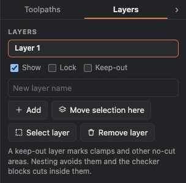
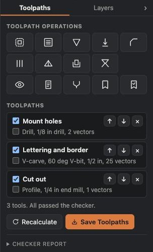
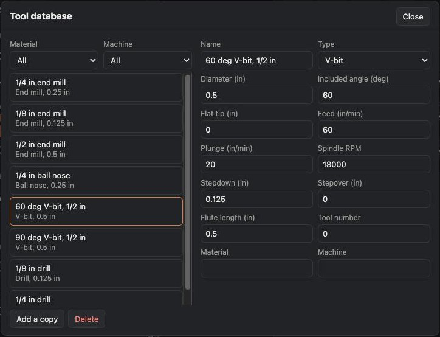
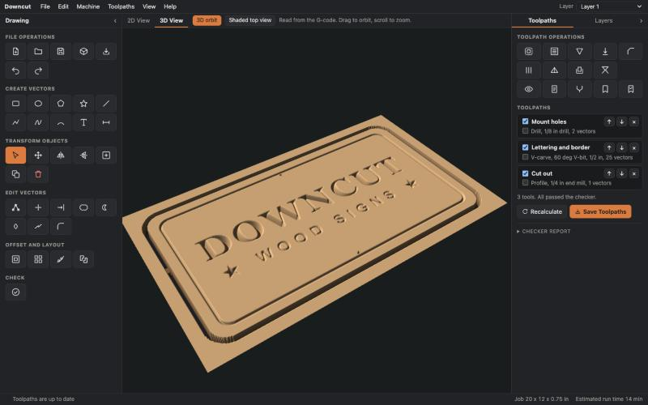
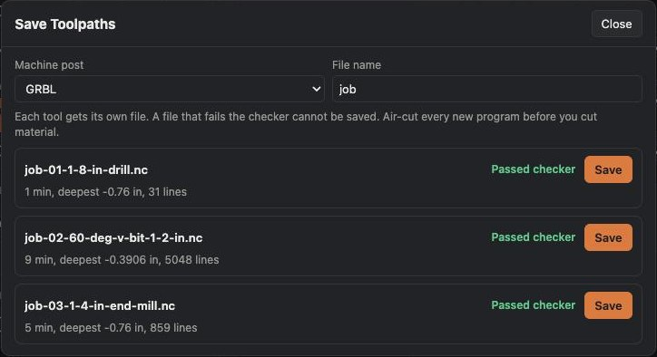
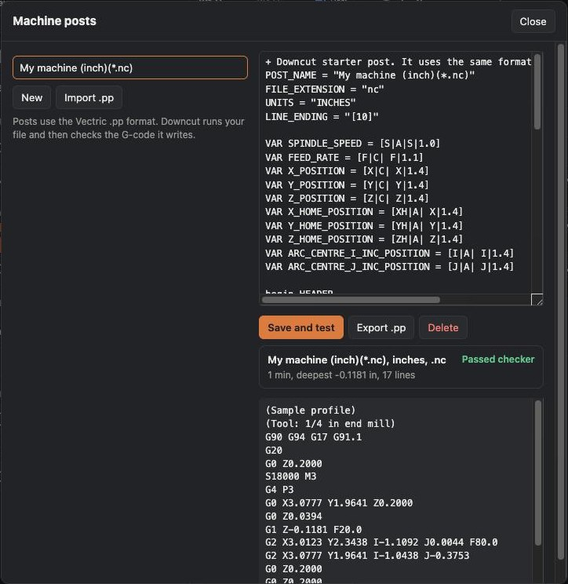

# Downcut User Guide

Downcut is free 2D and V-carve CAM for CNC routers. This guide covers every part of the program.

> [!WARNING]
> **Downcut is test software. Its author has not run it on a real CNC machine yet.** Bad G-code can break bits, ruin material, damage machines, and hurt people. Read every file, air-cut it above the material first, and keep a hand near the stop. Feeds and speeds are starting values only.

## Contents

1. [Install and start](#install-and-start)
2. [The basic workflow](#the-basic-workflow)
3. [The screen](#the-screen)
4. [Job Setup](#job-setup)
5. [Move around the sheet](#move-around-the-sheet)
6. [Create vectors](#create-vectors)
7. [Text](#text)
8. [Select and transform](#select-and-transform)
9. [Edit vectors](#edit-vectors)
10. [Offset and layout](#offset-and-layout)
11. [Layers and keep-out zones](#layers-and-keep-out-zones)
12. [Clean up art](#clean-up-art)
13. [Toolpaths](#toolpaths)
14. [Toolpath types](#toolpath-types)
15. [Inlays](#inlays)
16. [Tool database](#tool-database)
17. [Preview](#preview)
18. [Save toolpaths](#save-toolpaths)
19. [The G-code checker](#the-g-code-checker)
20. [Machine posts and Vectric files](#machine-posts-and-vectric-files)
21. [Tiling](#tiling)
22. [Setup sheet](#setup-sheet)
23. [File types](#file-types)
24. [Keyboard shortcuts](#keyboard-shortcuts)
25. [Troubleshooting](#troubleshooting)

## Install and start

Download your build from the [Releases page](https://github.com/quesohusker/downcut/releases).

| System | File | Start it |
|---|---|---|
| Mac, Apple silicon | `Downcut-macOS-AppleSilicon.zip` | Unzip, then open Downcut.app |
| Mac, Intel | `Downcut-macOS-Intel.zip` | Unzip, then open Downcut.app |
| Windows | `Downcut-Windows.zip` | Unzip the whole folder, then run `Downcut.exe` |
| Linux, x86-64 | `Downcut-Linux.tar.gz` | Unpack, then run `Downcut/Downcut` |

The builds are not signed, so your computer warns you the first time.

- **Mac:** Open the app once. Press **Done** on the warning, not Move to Trash. Then go to System Settings, Privacy & Security, scroll down, and press **Open Anyway**. Press **Open** when macOS asks again.
- **Windows:** On the SmartScreen warning, choose More info, then Run anyway.

Downcut starts a small local server and opens in your web browser. It needs no account and no internet. It serves only your own computer, at an address such as `http://127.0.0.1:8765`.

To stop it, use **File, Quit Downcut**. On first run, Downcut shows a safety notice. Read it, then press I understand.

## The basic workflow

1. Set the material size and zero position in **Job Setup**.
2. Draw vectors, add text, or import art.
3. Select vectors and pick a toolpath operation on the right.
4. Fill in the form and press **Calculate**.
5. Press F3 to see the simulated cut.
6. Press **Save Toolpaths** and save each file that passed the checker.
7. Read the G-code. Air-cut it. Then cut scrap.

To try this now, use **File, Open sample job**.

## The screen

| Area | What it does |
|---|---|
| Menu bar | File, Edit, Machine, Toolpaths, View, and Help. The layer picker is at the top right |
| Drawing panel, left | Tools for files, drawing, and editing. Hover over an icon to see its name |
| Center | 2D View and 3D View tabs |
| Right panel | Toolpaths and Layers tabs |
| Status bar | Pointer position, messages, job size, and estimated run time |

To hide a panel, press the small arrow at its top corner. A hidden panel becomes a side tab. Hover over the tab to peek at the panel, or click it to bring the panel back. F11 focuses on design, and F12 focuses on toolpaths. **View, Show both panels** restores both.

## Job Setup

Job Setup opens when you start an empty job. You can also open it with the box icon or **Machine, Job setup**.

| Field | Meaning |
|---|---|
| Width, Height, Thickness | Material size. A new inch job starts at 24 x 18 x 0.75 in. A new metric job starts at 600 x 400 x 18 mm |
| Units | Inches or millimeters. Downcut remembers your choice for new jobs. The Units box in the top bar sets the same thing |
| Z zero | Material top, or the spoilboard |
| XY zero | Any of the four corners, or sheet center. A red and green marker shows the spot on the sheet. Rulers, position readouts, and G-code all count from it |
| Safe Z | Height for rapid moves. Clamps must sit below this |
| Spoilboard allowance | How far a cut may pass through the bottom of the material |
| Machine | Bed size from an imported tool database. Downcut warns if the sheet is larger |
| Write arcs (G2, G3) | Off by default. Turn on for shorter files. Air-cut first |
| Tiling | See [Tiling](#tiling) |

## Move around the sheet

- **Zoom:** roll the mouse wheel, pinch on a trackpad, or press the **+** and **-** buttons. The wheel zooms at the pointer. On a trackpad, a two-finger scroll up or down zooms.
- **Pan:** hold Space and drag, drag with the middle or right button, or scroll sideways.
- **Fit:** press Fit, or use **View, Fit to sheet**.
- **Guides:** drag from a ruler onto the sheet. Drag a guide back to the ruler to remove it.
- **Snap:** Snap catches nodes, centers, midpoints, and guides. Grid snaps to the step you enter.

## Create vectors

| Tool | Key | How to use it |
|---|---|---|
| Rectangle | R | Drag corner to corner |
| Ellipse | E | Drag out from the center |
| Polygon | P | Drag out from the center. It has 6 sides |
| Star | S | Drag out from the center. It has 5 points |
| Line | L | Click two points |
| Polyline | O | Click points. Click the first point to close. Double-click or press Enter to finish |
| Curve | C | Works like Polyline. The curve passes through each point |
| Arc | A | Click the start, the end, then a point on the arc |
| Text | T | Opens the Text form |
| Dimension | M | Click two points. Remove one in Check, Clean Up, Export |

**Import art** reads SVG, DXF, PDF, AI, and EPS. Downcut places the art at the center of the sheet, and the status bar shows the imported size. Check that size. Old R12 DXF files carry no units, so Downcut reads them in the job's units.

- PDF text must be converted to outlines first.
- AI files must be saved as PDF compatible.
- EPS import reads common path commands only. If a file fails, save it as PDF or SVG.

## Text

Type your words, pick a font, and set the cap height. The four **Single Line** fonts are for engraving. Cut them with a Profile set to On the line.

- **Add text to sheet** places the text at the sheet center.
- **Add text on path** bends it along a path. First select a vector and press Set as path in Path and Boundary.
- On a circle, text centers at the top. **Flip** moves it to the bottom.
- **Lift off curve** raises the text off the path.
- **Kerning:** select the text, open the Text form, and use the plus and minus buttons for each letter pair. Rotating, mirroring, or resizing the text ends this.

## Select and transform

- Click a vector to select it. Text, imports, and array copies select as a group.
- Hold Shift and click to add or remove.
- Drag on empty space to box-select. A vector must sit fully inside the box.
- Drag a selection to move it. Drag a corner handle to scale it.
- Press Cmd or Ctrl and A to select all.

The Transform icons also mirror, center on the sheet, duplicate, and delete. **Move, Scale, Rotate** opens a form for exact X, Y, width, height, and angle. X and Y are the lower left of the selection.

## Edit vectors

| Tool | What it does |
|---|---|
| Edit nodes (N) | Click a vector, then drag its nodes. Double-click a span to add a node. Delete removes the picked node |
| Trim (X) | Click a span to remove it. It ends at the nearest crossings |
| Extend (J) | Click near an open end. It extends to the next vector |
| Weld | Joins closed shapes into one |
| Subtract | Keeps the oldest selected shape and cuts the others from it |
| Intersect | Keeps the shared area |
| Join | Connects open vectors whose ends sit within the tolerance |
| Close | Closes an open vector with a straight line |
| Smooth | Rounds a rough outline |
| Simplify | Reduces points. Use this before node editing imported curves |
| Remove duplicates | Removes copies and repeated points |
| Fillet | Rounds corners at a radius. Short edges limit the radius |
| Dog-bone, T-bone | Adds relief at corners so parts fit. Enter the tool diameter. Pick Pocket corners or Part corners |

Edits keep toolpaths attached where they can, so toolpaths follow your changes.

## Offset and layout

- **Offset:** a positive value grows the shape, and a negative value shrinks it. The original stays.
- **Arrays:** make grid or circular copies. Rotate each copy is optional.
- **Path and Boundary:** select a vector and press **Set as path**. Then select art and use **Copies along path** or **Trim to boundary**.
- **Nesting:** select parts and press **Nest selected parts**. Set the gap to at least your tool diameter. Parts can nest inside holes and avoid keep-out zones. A part that does not fit stays where it was.
- **Check vectors:** finds open vectors, crossings, duplicates, zero-length spans, and tiny shapes. Click a row to select the vector. For a bigger sweep, see [Clean up art](#clean-up-art).

## Layers and keep-out zones

New vectors go on the active layer. Pick it in the Layers tab or at the top right.

- **Show** hides or shows a layer.
- **Lock** stops selection on that layer.
- **Keep-out** marks closed vectors on the layer as no-cut zones.

Nesting avoids keep-out zones, and the checker blocks any cut that enters one, allowing for the tool radius. Toolpaths do not route around them. Rapids may still pass over them, so clamps must sit below Safe Z.

## Clean up art

Art from other programs often carries junk: two copies stacked on each other, lines that lap over a shape, and small specks left by a trace. Junk costs you real time. A stacked copy can erase its own cut, because Downcut treats a shape inside a shape as a hole.

Open **Check, Clean Up, Export** with the check icon, then press **Find problems**. Downcut checks all vectors on visible layers.

| Field | Meaning |
|---|---|
| Tiny size | A vector smaller than this in width and height counts as tiny |
| Overlap tolerance | Two lines closer than this count as on top of each other |

It reports three groups:

| Group | What it finds | What you can do |
|---|---|---|
| Copies and lines on top of others | Exact copies in any direction or start point, near copies, and open lines that sit on another vector | **Remove them** keeps one copy |
| Tiny shapes | Tiny rectangles, tiny shapes, tiny lines, and thin slivers | **Remove them** |
| Overlapping spans | Vectors that share part of a path | **Trim open lines** cuts the shared part from an open line. Closed shapes stay as they are. Weld them if they should be one shape |

Orange circles mark each item on the sheet. Click a row to zoom to it. **Select them** selects a whole group, so you can look before you remove. **Undo** restores anything you removed.

Review before you remove. A tiny shape can be real detail. On a 6 in test carving, 170 shapes came in under 0.5 mm, and many repeat in a pattern, so they may be real marks in the art.

The check is plain geometry. It runs on your machine, needs no account, and gives the same answer each time.

## Toolpaths

1. Select vectors.
2. Click an icon under Toolpath Operations. Hover to see its name.
3. Fill in the form and press **Calculate**.

Toolpaths follow their vectors when you move or edit them. Click a toolpath to edit it. In the list:

- The first checkbox includes the toolpath in the output.
- The second checkbox picks it for Merge or Save Template.
- The arrows change cut order. The list order is the cut order, so keep cut-outs last.
- The X deletes the toolpath.

**Repeat this toolpath** copies the cut in a grid with no new vectors.

**Merge picked toolpaths** joins toolpaths that use the same tool. Open the merged toolpath and press Split to undo it.

**Templates** save toolpath settings to a file. Applying one uses the current selection, or matching layer names if nothing is selected. Tools match by id or name. Through cuts follow the new material thickness.

## Toolpath types

### Profile

Cuts outside, inside, or on a line. Set the depth, allowance, and climb cut. Holes cut before outer edges.

- **Ramp length** ramps into the cut along the path.
- **Lead in and out** starts the cut off the part, with an arc or a line. Leads work on closed shapes and replace the ramp.
- **Keep tool down between passes** stays in the cut from one depth pass to the next, in place of a lift to clearance. Open lines cut back and forth.
- **Continuous ramp around the vector** spirals down the whole way, then makes one flat lap at the bottom. The drop per lap is the tool's stepdown. It replaces passes, ramps, and leads. Open lines ramp there and back.
- **Last pass stock** leaves this much on the wall during the depth passes, then takes it off in one full-depth lap. Use it for a clean wall with no pass lines. On a through cut, use tabs, because the part may move on that last lap.
- **Tabs** hold parts in place. Set the count, length, and thickness. Tabs work with all of the options above.

### Pocket

Clears an area and leaves islands. **Keep tool down between passes** stays in the cut from one level to the next. **Smaller tool for tight spots** adds rest machining: a smaller end mill cuts only what the main tool could not reach, such as inside corners. It saves as its own file, with its own tool change. Entry can be Plunge, Ramp, or Helix. A helix that does not fit falls back to a ramp. **Finish pass stock** roughs short of the wall, then takes a last lap.

### V-carve

Depth follows the width of the shape. **Flat depth** limits the depth. Add a **Clearing tool** to clear wide flat areas. **Start depth** is mainly for inlay plugs.

### Drill

Drills at the center of each closed vector, or at the first point of an open one. **Peck depth** retracts to clear chips.

### Chamfer

Cuts a chamfer of a set width with a V-bit, on an outside edge, inside edge, or line. **Tip clearance** moves the tip off the edge.

### Fluting

Runs along a vector with ramps at the start, end, or both. **Smooth ramp** eases the shape. Ball nose bits suit this best.

### Raised prism

Cuts with a V-bit so the shape rises to a ridge. If a shape is wider than the bit can reach, its top stays flat. Downcut warns you.

## Inlays

Select closed vectors, then pick an inlay operation. Downcut creates new vectors and toolpaths for the pocket and the plug. The plug is mirrored. If the plug does not fit beside the pocket, it sits on top and its toolpath is off. Turn the pocket off and the plug on when you cut the plug stock.

- **Auto-inlay** uses an end mill. **Fit clearance** sets the gap, and **Plug extra depth** leaves stock to sand flush.
- **V-carve inlay** uses a V-bit. **Glue gap** sets the space under the plug. Pocket depth must be within the reach of the bit. Add a clearing tool for wide areas.

## Tool database

Open it with **Machine, Tool database** or the Tools button in Job Setup.

Downcut includes 16 tools with starting values, 8 inch and 8 metric. A new toolpath picks a tool that matches the job's units. Replace them with your own numbers. **Add a copy** duplicates a tool. Delete is blocked while a toolpath uses the tool. Filter by material and machine. The filter also limits the tools shown in toolpath forms. Tools you import or add are kept in your browser's storage.

## Preview

Press F3, or use the 3D View tab, or the eye icon in Toolpaths.

The preview cuts a height map from the G-code text. Drag to orbit, and scroll to zoom. **Shaded top view** shows the same result from above. Dark areas are cut through. **Checker report** in the right panel lists each file.

**Depth passes:** when a Profile or Pocket has more than one pass, a slider appears above the view. Move it to see one pass at a time. In 2D it draws only that pass. In 3D it stops the cut at that depth. Move it to the far left to see all passes.

The preview is a simulation. It does not show machine limits, clamps, or tool holders.

## Save toolpaths

Press **Save Toolpaths**, pick the machine post, and enter a file name. A new file starts at each tool change, so cut order is kept. Run the files in number order. A file that fails the checker cannot be saved.

Run times ignore acceleration, so they run low.

## The G-code checker

A separate checker reads each finished file. It shares no code with the toolpath engine.

**It blocks a file that:**

- Moves in XY at rapid speed below Safe Z
- Plunges into the material at rapid speed
- Cuts below the allowed floor, or leaves the sheet
- Enters a keep-out zone
- Cuts with no feed rate or with the spindle off
- Ends below Safe Z, or leaves the spindle on
- Uses G91, comma decimals, an arc plane other than G17, or a coordinate-shifting G92
- Has a bad arc, or moves before units are set

**It only warns about:**

- Machine-coordinate moves such as G53, G28, and G30. It cannot follow them, so review them yourself
- Tool changes, because it skips the moves the controller makes
- A plain G92 zero at the start of a program

With imported posts, three items become warnings: no spindle start, no end code, and an XY move before Z is known. A post that does not write G-code stays blocked, because the checker cannot read it.

## Machine posts and Vectric files

Downcut includes GRBL, Mach3 and Mach4, and LinuxCNC posts. Use **Machine, Import Vectric file** to add your own files. Downcut ships no Vectric files. It is not made by or connected with Vectric.

### `.pp` post processors

Downcut runs your post's own blocks and variables, then checks the result. Open **Machine, Machine posts** to edit a post. **Save and test** shows sample G-code and a checker result. **New** starts from a simple post.

Supported blocks include HEADER, FOOTER, TOOLCHANGE, NEW_SEGMENT, SPINDLE_ON, RAPID_MOVE, INITIAL_RAPID_MOVE, FEED_MOVE, PLUNGE_MOVE, RETRACT_MOVE, FEED_RATE_CHANGE, the arc and helical arc blocks, and their FIRST_ forms.

Not supported:

- Rotary posts and POST_BASE posts are refused.
- Laser, tape splitting, and drill bank sections are skipped.
- Each tool saves as its own file, so one file with automatic tool changes is not possible yet.

If a post sets no units, Downcut adds G20 or G21 and tells you. If it never starts a spindle, Downcut tells you to start the router by hand. Compare the first output from any post with a file you trust.

### `.vtdb` tool databases

Downcut reads tools, feeds, speeds, materials, and machine bed sizes. Bowl bits import as end mills, and tapered ball nose bits import as ball nose bits, so their shapes are simplified. Downcut tells you when this happens. Only inch values and in/min feeds have been seen in a real file, so check other units in the tool database.

## Tiling

Tiling splits a job larger than your bed. Turn it on in Job Setup and enter the tile size and overlap. Purple lines show the tiles on the sheet.

Each tile gets its own files, named by row and column, such as `tile-r1c2`. Each tile's coordinates start at that tile's own corner, so reset your zero on the sheet before you start each tile. The overlap is cut twice, once from each tile.

## Setup sheet

Press the sheet icon or use **File, Setup sheet**. It lists the setup, files in cut order, tools, feeds, times, warnings, and the simulated cut. You can print it or save it as HTML.

## File types

| Item | Format |
|---|---|
| Project | `.downcut`. Older `.kerfline` files also open |
| G-code | `.nc` for GRBL, `.tap` for Mach3 and Mach4, `.ngc` for LinuxCNC, or the extension your post sets |
| Vector import | SVG, DXF, PDF, AI, EPS |
| Vector export | SVG, DXF |
| Toolpath template | `.downcuttemplate` |
| Setup sheet | `.html` |
| Machine post | `.pp` |

Your work is also kept as a draft in your browser, but drafts are tied to that browser and address. Save a `.downcut` file for anything you want to keep.

## Keyboard shortcuts

| Key | Action | Key | Action |
|---|---|---|---|
| F2 | 2D view | V | Select |
| F3 | 3D view | R | Rectangle |
| F11 | Design layout | E | Ellipse |
| F12 | Toolpath layout | P | Polygon |
| Cmd/Ctrl Z | Undo | S | Star |
| Shift Cmd/Ctrl Z | Redo | T | Text |
| Cmd/Ctrl D | Duplicate | L | Line |
| Cmd/Ctrl A | Select all | O | Polyline |
| Delete | Delete | C | Curve |
| Esc | Cancel and clear the selection | A | Arc |
| Enter | Finish a polyline or curve | N | Edit nodes |
| Space | Hold and drag to pan | X | Trim |
| M | Dimension | J | Extend |

macOS may claim F11 and F12. The same layouts are in the View menu.

## Troubleshooting

| Problem | What to do |
|---|---|
| The browser did not open | Windows and Linux show the address in the console window. Open it by hand |
| A file will not save | Read the reasons under the file in Save Toolpaths. Fix the toolpath or Job Setup |
| "Tool is too large" | Use a smaller bit, or a larger shape |
| Corners stay uncut | Reduce the stepover, or use a smaller bit |
| Text has no shapes | The font may lack those characters. Try another font |
| A font is missing | Downcut reads fonts from the system folders it can reach |
| The 3D view does not start | Your browser needs WebGL2. The shaded top view still works |
| A PDF import fails | Convert text to outlines, or save the art as SVG |
| A `.pp` file is refused | Read the message. Rotary and POST_BASE posts are not supported |
| A shape cuts nothing | Two stacked copies cancel out. Use [Clean up art](#clean-up-art) |
| Imported art is the wrong size | Check the size in the status bar. Old DXF files have no units, so set the job's units first, then import again |

To report a problem, open a [test report](https://github.com/quesohusker/downcut/issues/new?template=test-report.md). Tell us your machine, controller, and post.
